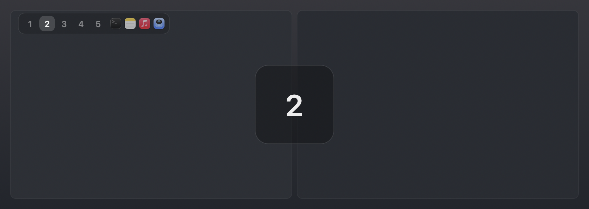

# aerospace-hud

A lightweight per-monitor workspace HUD for [AeroSpace](https://github.com/nikitabobko/AeroSpace).

Each display gets a small floating panel in its top-left corner showing the
workspaces on that monitor and the app icons of the windows in the focused one.
On a workspace switch, a large workspace number briefly fades in over the
center of the display it happened on.



*Rendered mockup: the floating panel (workspaces + focused-workspace app icons)
top-left, and the center switch overlay. Colors, sizes and radii are taken
straight from the drawing code.*

It is a single self-contained Swift file using only AppKit — no sketchybar, no
menu-bar helper, no configuration file. It talks to AeroSpace purely through the
`aerospace` CLI.

## Why

AeroSpace is a tiling window manager, not a bar. Most people wire up a workspace
indicator with sketchybar or a similar bar framework. This is the smaller
alternative: one binary, driven by AeroSpace's `exec-on-workspace-change`
callback, that draws a HUD on every screen and stays out of the way otherwise.

## Requirements

- macOS with the Swift toolchain (`/usr/bin/swiftc`, i.e. Xcode or the Command
  Line Tools)
- [AeroSpace](https://github.com/nikitabobko/AeroSpace) on `PATH` (Apple Silicon
  and Intel Homebrew prefixes are both detected; override with `AEROSPACE_BIN`)

## Install

```sh
git clone https://github.com/PannenetsF/aerospace-hud.git
cd aerospace-hud
./start-aerospace-hud.sh
```

The launcher compiles `workspace_indicator.swift` on first run (and whenever the
source is newer than the cached binary), caches the binary under
`~/Library/Caches/aerospace-hud`, and execs it.

Then tell AeroSpace to touch the dirty file whenever the workspace changes. In
`~/.config/aerospace/aerospace.toml`:

```toml
exec-on-workspace-change = ['/bin/sh', '-c', 'printf . > /tmp/aerospace-workspace-indicator-dirty']
```

The HUD watches that file and refreshes on change (plus a 10s safety poll and an
immediate redraw on display reconfiguration / wake).

### Run it at login

Point a `launchd` user agent at `start-aerospace-hud.sh` with `RunAtLoad` and
`KeepAlive`. A minimal `~/Library/LaunchAgents/com.example.aerospace-hud.plist`:

```xml
<?xml version="1.0" encoding="UTF-8"?>
<!DOCTYPE plist PUBLIC "-//Apple//DTD PLIST 1.0//EN" "http://www.apple.com/DTDs/PropertyList-1.0.dtd">
<plist version="1.0">
<dict>
    <key>Label</key><string>com.example.aerospace-hud</string>
    <key>Program</key><string>/absolute/path/to/aerospace-hud/start-aerospace-hud.sh</string>
    <key>RunAtLoad</key><true/>
    <key>KeepAlive</key><true/>
</dict>
</plist>
```

```sh
launchctl bootstrap "gui/$(id -u)" ~/Library/LaunchAgents/com.example.aerospace-hud.plist
```

## Configuration

All optional, via environment variables:

| Variable | Default | Purpose |
| --- | --- | --- |
| `AEROSPACE_BIN` | auto-detected | Path to the `aerospace` CLI |
| `AEROSPACE_HUD_SOURCE` | next to the launcher | Swift source to compile |
| `AEROSPACE_HUD_CACHE` | `~/Library/Caches/aerospace-hud` | Compiled-binary cache dir |
| `AEROSPACE_HUD_LOG` | `~/Library/Logs/aerospace-hud/aerospace-hud.log` | Build/runtime log |
| `AEROSPACE_HUD_DIRTY` | `/tmp/aerospace-workspace-indicator-dirty` | Dirty file AeroSpace touches |
| `AEROSPACE_RECONFIGURE` | unset | Optional helper run on display-layout change (see below) |
| `AEROSPACE_INDICATOR_DEBUG` | unset | Set to `1` for timestamped stderr tracing |

The dirty-file path can also be passed as the first CLI argument to the compiled
binary; the environment variable is what the launcher uses.

### The `AEROSPACE_RECONFIGURE` hook

AeroSpace does not re-apply `workspace-to-monitor-force-assignment` when a
monitor reconnects ([AeroSpace#520](https://github.com/nikitabobko/AeroSpace/issues/520)).
If you have multi-monitor workspace assignments that need to self-heal on
lid-close / undock / power-loss reconnect, set `AEROSPACE_RECONFIGURE` to an
executable that waits for the display layout to settle, re-renders your config,
and re-homes the workspaces. The HUD runs it (debounced, with retries) on every
display-layout change. Leave it unset and the HUD simply skips that step — it is
not required for the indicator itself.

## Design notes

- **Per-display state is keyed by `CGDirectDisplayID`**, not by localized name,
  so two identical monitors (e.g. a pair of DELL U2720Q) don't collide and a
  name remapping after reconnect doesn't strand a panel.
- **`aerospace` is invoked with a hard timeout** and completion observed via
  `terminationHandler` rather than a parked `waitUntilExit()`, so a slow CLI
  call right after wake cannot leak threads and freeze the HUD over time.
- **Display-change bursts are coalesced** so panels rebuild once after the
  layout settles instead of thrashing through each intermediate notification.

## License

[MIT](LICENSE)
